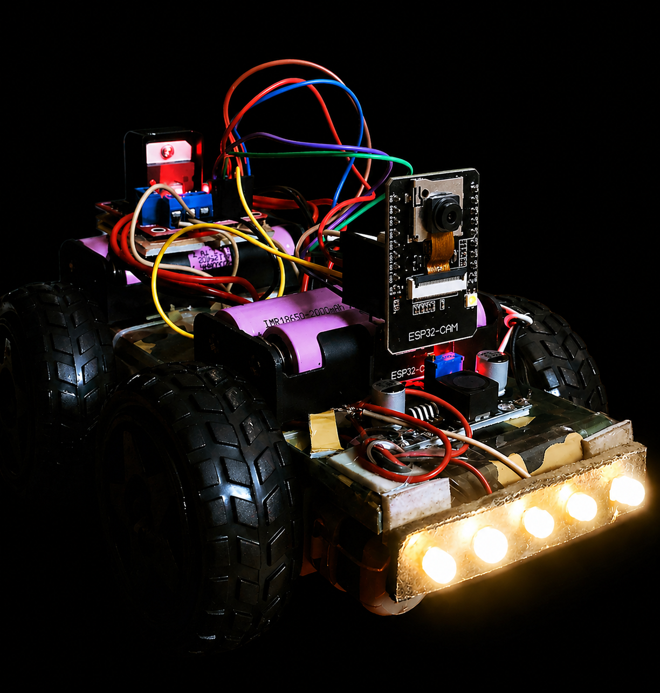

# AI Surveillance Car Using ESP32-CAM

## Project Gallery

---

## Project Overview

An ESP32-CAM-based Wi-Fi-controlled surveillance car developed to provide wireless movement control and live camera streaming through a mobile browser.

## Key Features

- Wireless car movement control
- Live video streaming using ESP32-CAM
- Mobile browser access through Wi-Fi
- Motor control using L298N motor driver
- Compact embedded hardware integration

## Hardware Components

- ESP32-CAM AI Thinker
- OV2640 Camera Module
- L298N Motor Driver
- DC Gear Motors
- Car Chassis and Wheels
- 3.7V Li-ion Batteries
- 5V Buck Converter
- FTDI Programmer

## Technologies Used

- Embedded C
- Arduino IDE
- ESP32
- Wi-Fi Communication
- IoT
- Hardware Interfacing

## Working Principle

The ESP32-CAM connects to a Wi-Fi network and provides a live video stream accessible through its IP address in a mobile browser. The motors are controlled through the L298N motor driver, enabling wireless movement of the car.

## My Role and Learning Outcomes

- Worked on hardware integration and interfacing.
- Explored ESP32-CAM configuration and camera streaming.
- Learned motor control using the L298N driver.
- Gained practical experience with Wi-Fi-based embedded systems.

## Achievement

**First Prize – Technostav 2K26**

## Project Details

| Category | Details |
|---|---|
| Project Domain | Embedded Systems and IoT |
| Controller | ESP32-CAM |
| Programming | Embedded C / Arduino IDE |
| Project Status | Completed – 2026 |
| Achievement | First Prize – Technostav 2K26 |

---

**Note:** This repository contains project documentation and source code. Wi-Fi credentials are represented using placeholders.
